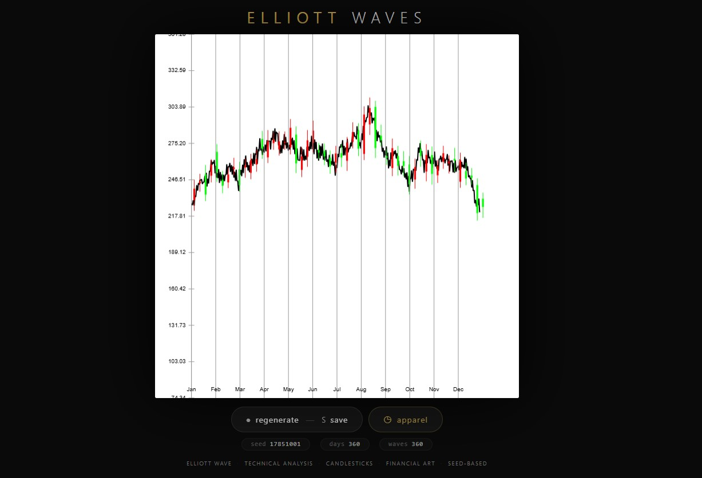
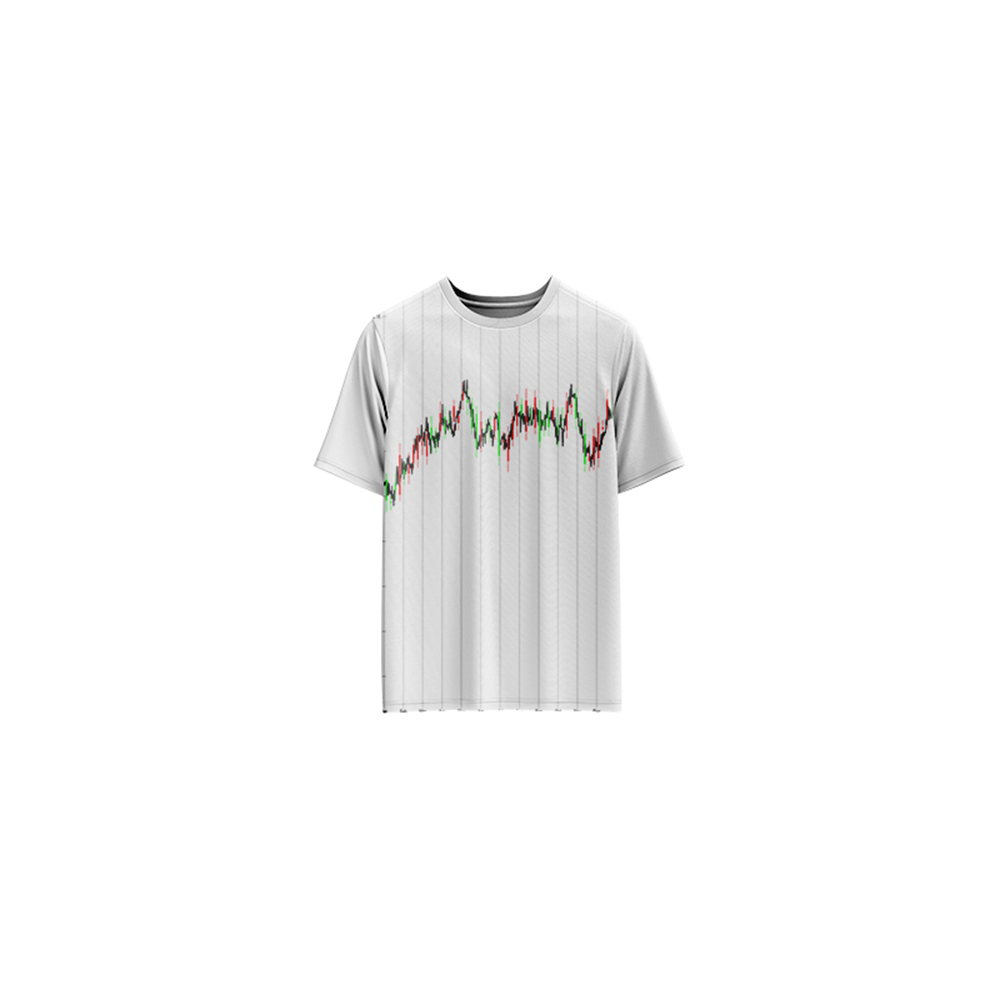

# Elliott Waves — Generative Art

[](https://reyrove.github.io/Elliott-Waves-Generative-Art)
[](https://opensource.org/licenses/MIT)

> **Generative financial chart art.** Each refresh creates a unique Elliott Wave pattern with candlesticks, technical analysis aesthetics, and random market movements.

## 🎨 Live Demo

<div align="center">
  <a href="https://reyrove.github.io/Elliott-Waves-Generative-Art" target="_blank">
    
  </a>
  <br><br>
  <a href="https://reyrove.github.io/Elliott-Waves-Generative-Art" target="_blank">
    
  </a>
  <br>
  <em>Click the image or button to experience the generative art</em>
</div>

## 👕 Apparel Preview

<div align="center">
  
  <br>
  <em>Elliott Waves artwork printed on a T-shirt</em>
</div>

## ✨ Features

- **Elliott Wave Patterns** — Impulse and correction waves with random variations
- **Candlesticks** — Weekly candlestick charts with green/red colors
- **Technical Analysis Aesthetic** — Financial chart styling
- **Monthly & Y-Axis Labels** — Professional chart appearance
- **Random Market Movement** — Unique price action every time
- **Seed-Based** — Every composition is unique and reproducible via its seed
- **Save & Share** — Download as PNG with seed in filename
- **Apparel Mode** — Preview artwork on a T-shirt mockup
- **Responsive** — Works on desktop, tablet, and mobile
- **Pure JavaScript** — No external dependencies
- **Keyboard Shortcuts**:
  - `R` — Regenerate
  - `S` — Save image
  - `T` — Toggle apparel view

## 🎨 Artwork Details

| Parameter | Value | Description |
|-----------|-------|-------------|
| **Trading Days** | 360 | Number of data points |
| **Weeks** | ~51 | Weekly candlesticks |
| **Months** | 12 | Monthly axis labels |
| **Y-Axis Ticks** | 10 | Price levels |
| **Wave Type** | Elliott | Impulse and correction waves |

## 📈 The Elliott Wave Theory

The Elliott Wave Theory is a form of technical analysis that identifies recurring wave patterns in financial markets. It consists of:

- **Impulse Waves** (5 waves): Move in the direction of the trend
- **Correction Waves** (3 waves): Move against the trend

This artwork generates random variations of these patterns, creating unique market-like visualizations.

## 🚀 Quick Start

### Local Development

```bash
# Clone the repository
git clone https://github.com/reyrove/Elliott-Waves-Generative-Art.git

# Navigate to the directory
cd Elliott-Waves-Generative-Art

# Open in browser
open index.html
# or use a live server
```

### Deploy to GitHub Pages

1. Push to GitHub
2. Go to Settings → Pages
3. Select branch `main` and root folder
4. Your site will be live at `https://reyrove.github.io/Elliott-Waves-Generative-Art`

## 🧠 How It Works

The artwork is generated using a deterministic random number generator, seeded by timestamp + random noise. Every refresh:

1. **Setup**:
   - 360 trading days
   - Random Elliott Wave patterns
   - Random price movements

2. **Wave Generation**:
   - Impulse and correction waves
   - Random direction and amplitude
   - Variable wave width and height

3. **Candlesticks**:
   - Weekly candlesticks (7-day intervals)
   - Green for up weeks, red for down weeks
   - Random open, close, high, low prices

4. **Chart Elements**:
   - Y-axis with price levels
   - Monthly axis labels (Jan-Dec)
   - Professional chart styling

## 📁 File Structure

```
Elliott-Waves-Generative-Art/
├── index.html          # Main application (all-in-one)
├── Elliott-Waves.jpg   # T-shirt mockup image
├── fav.svg             # Favicon
├── demo-screenshot.jpg # Website demo screenshot
├── README.md           # This file
└── LICENSE             # MIT License
```

## 🛠️ Tech Stack

- **Pure Vanilla HTML/CSS/JS** — No dependencies
- **Canvas API** — 2D rendering
- **CSS Flexbox/Grid** — Responsive layout
- **GitHub Pages** — Hosting

## 🎯 Interactive Controls

| Action | Keyboard | Button |
|--------|----------|--------|
| Regenerate | `R` | Click "regenerate" |
| Save Image | `S` | Click "regenerate" |
| Toggle Apparel | `T` | Click "apparel" |

## 🎨 The Creative Process

### Elliott Wave Generation
The artwork generates wave patterns with:
- Alternating impulse and correction waves
- Random direction (up/down)
- Random amplitude and width
- Smooth wave transitions

### Candlestick Chart
Weekly candlesticks are drawn with:
- Green bodies (close > open)
- Red bodies (open > close)
- Wick lines showing high and low
- Random price variations

### Chart Styling
The chart includes professional elements:
- Monthly labels (Jan-Dec)
- Y-axis price levels
- Grid lines for reference

## 📱 Responsive Design

The application automatically adapts to:
- Desktop screens
- Tablets
- Mobile phones
- Landscape orientation
- Various aspect ratios

## 🤝 Contributing

Contributions are welcome! Feel free to:
- Fork the repository
- Create a feature branch
- Submit a pull request

### Ideas for Contributions:
- New wave patterns
- Additional chart indicators
- Animation features
- More candlestick patterns
- Performance optimizations

## 📄 License

MIT License — see [LICENSE](LICENSE) file for details.

## 🙏 Acknowledgments

- Inspired by the Elliott Wave Theory
- Technical analysis aesthetics
- Pure JavaScript implementation
- Special thanks to the creative coding community

---

**Built with ❤️ and market waves**